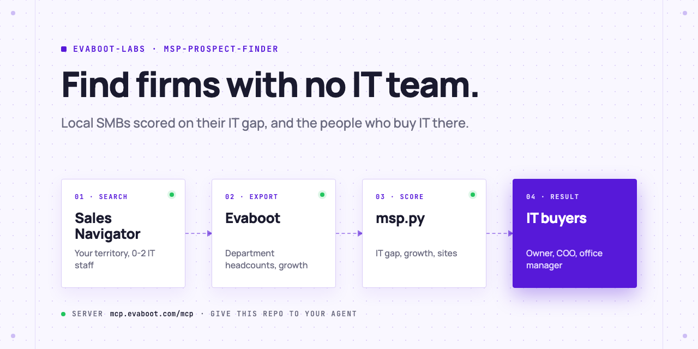

<picture>
  <source media="(prefers-color-scheme: dark)" srcset=".github/assets/banner-dark.png">
  
</picture>

# MSP prospect finder

Your AI agent finds the small and mid-size firms in your territory that need a managed service provider: it runs a Sales Navigator account search for firms with 0 to 2 IT people, scores each one on its IT gap (IT headcount, size, growth, several sites, headquarters in your territory), then exports the owners, COOs, operations and office managers of the firms it keeps, with verified emails. You do the outreach.

[](AGENTS.md)
[](https://evaboot.com/mcp)
[](LICENSE)

## Set it up in one prompt

Paste this into Claude Code, Codex or Cursor:

```text
Clone https://github.com/evaboot-labs/msp-prospect-finder, read AGENTS.md and follow the skill. Find firms in my territory that need outsourced IT, and who buys IT there.
```

<details>
<summary>Or install the skill</summary>

Claude Code:

```text
/plugin marketplace add evaboot-labs/msp-prospect-finder
/plugin install msp-prospect-finder@evaboot-labs-msp-prospect-finder
```

Codex, Cursor and other agents:

```bash
npx skills add evaboot-labs/msp-prospect-finder
```

</details>

## How it works

**1. Search accounts in your territory.** Your agent writes your territory and verticals into [`TARGETS.md`](TARGETS.md) and builds a Sales Navigator account search with Evaboot, then adds the filter that matters most to an MSP: an Information Technology department of 0 to 2 people. In our test (law, accounting and medical practices of 11 to 200 people in Dallas-Fort Worth) it left 436 firms, and 107 once headcount growth above 10% was added.

**2. Score every firm on its IT gap.** The export holds each firm's department headcounts, exact size, growth and headquarters address. `msp.py` gives points for each, and drops a firm headquartered outside your territory: the headquarters filter also returns firms with only a branch in the area.

```text
$ python3 msp.py score data/accounts.json
| yes | 7 | BVWD          | 0 | 88  | 31% | no IT person on LinkedIn; 88 employees; +31% staff in 1 year |
| no  | 3 | Quilling, ... | 1 | 117 | 9%  | one IT person; 117 employees |
| no  |   | Early Medical | 0 | 11 to 50 | 23% | headquarters outside your territory (Austin, Texas, United States) |

3 of 10 companies kept.
```

**3. Then the people who buy IT.** In a firm with no IT team, that is the owner, the COO, the operations lead or the office manager. `msp.py people-url` turns the kept firms into a people search for those titles. In our test it found 18 people at 3 firms; the export of 10 kept 5 local buyers, all 5 with a safe email.

**4. Or run it in n8n.** Every Monday, the firms new to your search are scored and their IT buyers land in a Google Sheet. No AI key needed.

## What you need

- An [Evaboot account](https://dash.evaboot.com/accounts/signup/?last_click_origin=msp-prospect-finder-repo) and a Sales Navigator seat.
- An AI agent that can use an MCP server: Claude Code, Codex, Cursor, or the n8n version.
- Python 3.9+, with no packages to install.
- Cost: 1 Evaboot credit per exported company and per exported person, verified email included.

## Go further

| Page | For |
|---|---|
| [docs/connect-your-agent.md](docs/connect-your-agent.md) | The setup by hand, for each agent |
| [docs/n8n.md](docs/n8n.md) | The same finder in n8n, every Monday, into a Google Sheet |
| [TARGETS.md](TARGETS.md) | Your territory, the IT gap points and who to reach |

---

Agents: start at [AGENTS.md](AGENTS.md) · Built by [Evaboot](https://evaboot.com) · More workflows at [github.com/evaboot-labs](https://github.com/evaboot-labs) · [MIT license](LICENSE)
